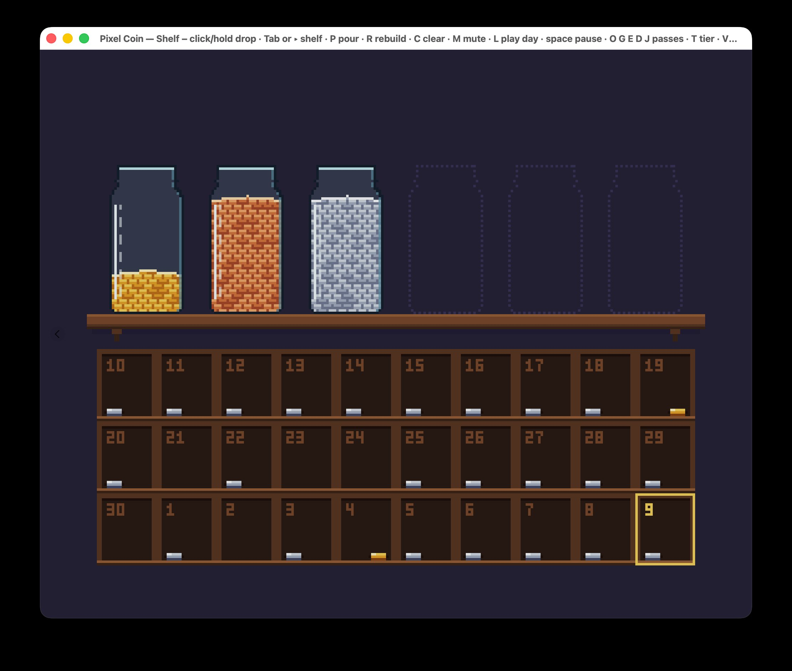

# 稳妥的选择

大多数新手都觉得，跟着市场潮流做才稳妥。做一个大家好像都想要的 App，起码还有机会。我以前也这么想。有好几个星期，我一直在纠结：该做大家都喜欢的 App，还是做我自己喜欢的？

我现在的答案是：对刚入门的 App 开发者来说，追潮流并没有看上去那么稳。反正大多数 App 都赚不了多少钱，倒是你自己每天要用的那个，你才会一直改下去。

## 这个问题是怎么来的

我看了 Jonathan Blow（《Braid》《The Witness》）和 Edmund McMillen（《Super Meat Boy》《The Binding of Isaac》）聊他们为什么只做自己想玩的游戏。有一句话我一直记着：

> 「我宁可做一款游戏，玩的人不多，但他们都把它当成这辈子最爱；也不想做一款很多人都觉得『还行』的游戏。」

他们拿另一种做法开玩笑：为「喜欢……《阿凡达》之类的 15 到 19 岁的人」设计游戏。「这到底是什么意思？」Blow 问，「我猜就是看看别的游戏，然后照抄吧。」

这是两位大牌开发者的建议，听着挺有道理。可他们有名，恰恰是因为他们成了。所以我想去看看，别的这么干的人后来怎么样了。

## 我的 App，和我没跟的潮流

我在做一个叫 Time-Cost-Averaging 的 App，用来往几项技能上「投资时间」。你选一项技能，开始一段 25 分钟的专注，App 会记下你在每项技能上一共花了多少时间。名字来自「定投」（dollar-cost averaging）：按固定节奏投固定的钱，不去猜什么时候该入场。

计时类 App 通常长得像仪表盘：倒计时、图表、总数，一大堆文字。

我的一样都没有。说白了，它是个披着 App 外衣的游戏：像素画风，一个字的说明都没有。

- 每完成一段 25 分钟，就装满一个玻璃罐的**铜币**。正常一天大概四段，也就是四个新罐子。
- 罐子放在架子上，**架子大小是固定的**：只放得下 6 个罐子。到第二天就满了。
- 想腾地方，就得**把铜币换成银币和金币**。换完体积够小，可以丢进架子下面的格子里，每天一格。

有了这个架子，它就不只是好看而已。架子一满，你就得把罐子兑掉，给下一个腾地方，而每次兑换都有回报：金币堆在当天的格子里，配上动画和硬币掉落的声音。有硬限制，又有奖励，这才算得上是游戏。而且这个固定的架子，和我[上一篇文章](https://ai-companion-newsletter.beehiiv.com/p/calendar-time)讲的是同一件事：一天的时间是有限的，所以你没法一直往上加目标。架子只是把这一点摆到了眼前。

我喜欢金币。喜欢看它们堆起来，喜欢听它们掉下去的声音。这是我的口味，有几个朋友说他们也一样。

## 理由一：销量决定不了这件事

如果跟着市场走更稳，那追潮流的 App 应该更常赚到钱。我没找到直接比较这两条路的数据。我只找到一件事：不管 App 还是游戏，收入都是同一条很陡的长尾，绝大多数几乎赚不到钱。

App Store 的数据比较老，也不太完整，但能看出这条长尾（Perry, 2015）。Steam 的数据新一些：2019 年发布的游戏，终身收入的中位数是 **1,136 美元**，还没扣 Steam 的分成（Zukowski, 2022，数据来自 Video Games Insights）。只有大约十分之一超过了 20 万美元。

「为自己做」也逃不开这个概率。《Where the Water Tastes Like Wine》做了四年，卖出的份数比开发者的 Twitter 粉丝还少（CGMagazine, 2018）。Boomzap 的 CEO 是这么说《Last Regiment》的：「有一小群人非常爱这款游戏，声音也很大，但世界上其他人都不想要它」（PocketGamer.biz, 2021）。这就是 Blow 说的「很少人的最爱」，只是没换来销量。

所以，我没有证据说为自己做*卖得更好*。但我也没有证据说跟市场走就卖得更好。反正几乎什么都赚不了多少，拿销量当理由去选「稳妥」那条路，说不通。得看别的。

## 理由二：一个永远不会走的用户

为自己做，有一样东西是跟市场走给不了的：一个每天都会来的用户。

我在好几项技能上投入时间，我需要看到自己一共投了多少，投的时候还要有即时反馈：硬币掉下来。正因为我离不开这个反馈，它一没了或者手感不对，我马上就能发现。然后我就去修。用、发现、修、再用。

要是你给一个想象出来的「15 到 19 岁的人」做 App，缺了什么就只能靠猜。我只要打开 App 就行。我觉得就是这个循环，让那些做给自己天天用的人，更容易一直改下去。目前的证据只有一个人：我自己。App 会记录每一段专注，所以再过几个星期，我就能知道自己是真的每天在用，还是只是以为自己在用。

## 长得不一样，还有不写说明的风险

像素风的罐子、往下掉的硬币，放在 iPhone 上，跟别的计时 App 都不一样。这正是 Blow 和 McMillen 的观点：大家都在做自己以为市场想要的东西，结果做出来全一个样，这时候一个很个人的 App 反倒显眼。

但显眼不代表有人找得到它。很多有特色的游戏也只卖了几千份。

更大的风险是我决定不放文字说明。我希望大家看一点小提示，就能自己摸出来怎么兑换。前提是这个比喻得是常识，不能只是我自己的习惯。硬币、罐子、架子满了，这些谁都懂。Blow 在《The Witness》里做过类似的事：游戏里「没有任何文字或对话直接解释谜题的规则」，规则是谜题自己教给你的。不过我还是得测试：把 App 交给几个人，什么也不说，看着他们玩。

## 老实说，有两个局限

**我不是典型的新手。** 我刚接触 App 和游戏，但以前是做后端开发的。我已经知道怎么把一个软件做完。要是你什么都没发布过，这个循环照样有用，只是在它转起来之前，你得多学不少东西。

**我需要靠这个赚钱。** 这不是爱好。上面说的都是选*哪条*路，不是说哪条路能赚钱。第一个 App，大概率走哪条路都赚不到钱。Blow 和 McMillen 说，观众要靠「几款游戏」慢慢积累。你得一直把自己做的东西拿给人看，「直到聚起足够多的人，让它能撑下去」。

## 那你该怎么办？

如果你正把自己的想法搁一边，去追那些看着稳妥的东西，不妨算笔账：你丢掉的，是一个肯定会有的用户、一股肯定会有的劲头；换来的那点销量机会，其实跟另一条路差不多。

我的建议是：做个你自己每天都会打开的东西，用别人一看就懂的比喻。还有，做好不止做一个 App 的准备。

或者像 McMillen 在对话最后开玩笑说的：「待在家里，做点酷东西吧。」

---

## 参考资料

- Blow, J., & McMillen, E. (2026, October 6). [对话片段，"gamedev cuts"](https://youtu.be/gBpuZNFssCM)。引文来自自动字幕，说话人由我根据视频辨认。
- CGMagazine (2018). [《Where the Water Tastes Like Wine》复盘：独立开发的惨淡图景](https://www.cgmagonline.com/news/where-the-water-tastes-like-wine-postmortem-paints-a-bleak-picture-of-indie-development/)。
- Perry, C. (2015, January). [App Store 的形状](https://www.macstories.net/?p=37727)。*MacStories*。
- PocketGamer.biz (2021, April 20). [专访 Boomzap 的 Christopher Natsuume](http://www.pocketgamer.biz/boomzap-christopher-natsuume-last-regiment/)。
- [《The Witness》（2016 年电子游戏）](https://en.wikipedia.org/wiki/The_Witness_(2016_video_game))。Wikipedia。
- Zukowski, C. (2022, November 28). [独立游戏的中位数收入并不高](https://howtomarketagame.com/2022/11/28/the-median-indie-game-does-not-earn-a-whole-lot/)。*How To Market A Game*。
