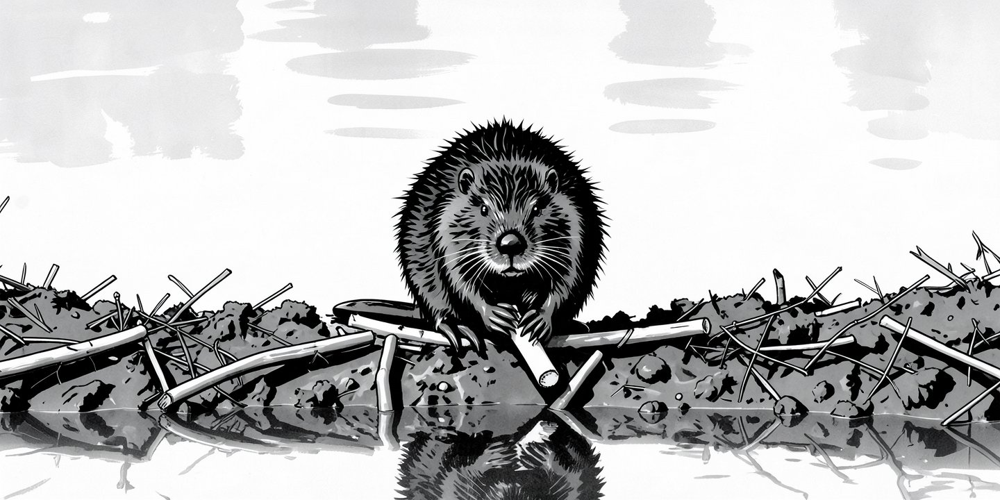
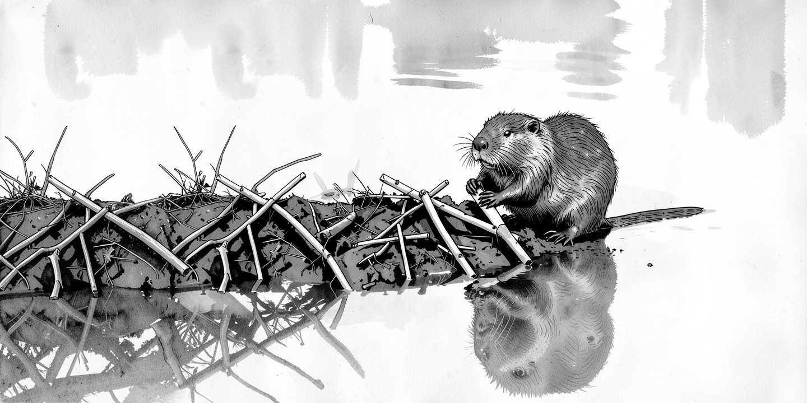

# automate cover generation

我家的主菜是大集上的圆白菜。今天多买了一捆菠菜心。嫩绿色的粗茎上面有很多深绿色的无齿厚叶，一捆腰上系着根红绳。顶上有好几簇亮黄色的小花，十分漂亮。

我切完豆腐块，放进空气炸锅，定好十二分钟，炸锅就开始嗡嗡地忙上了。

我用带齿的短刀立在圆白菜根处一按，“叭”，那里就裂开了。我一片片剥下包叶，剔掉两侧的绿叶，留下中间的厚茎，再换上没齿的菜刀切成薄片。圆白菜切完，另一边的炸锅也停了。

我取出菠菜心，解开红绳，放平整捆菜心，让粗茎冲前。我右手提刀，左手按菜，从菜茎切到菜花。一分钟不到，切完了。

距离午饭还早，我回到电脑前，继续弄我文章的配图。

以前，配图都是我自己动手。右手的光标在一段英文开头按下，拖下来几行，停在段尾。左手在键盘上按下复制组合键，再把光标挪到浏览器的页面一处，找到文生图工作流，再点在文字框的空白处，左手按下粘贴组合键。那段描写就粘过来了。描写的内容是AI生成好的配图提示词。

我向右拖动流程图，露出配置节点，找到「生成字段」，改成「随机」，然后按下回车键。第一个生图任务开始了。

我又按了五下回车，排上了五个生图任务。我的Mac mini上生一张图要3分钟左右。我会从六张不同配图里挑一张最好的。我可不想盯着电脑生图。一次排满更高效。二十分钟后，我再回来选。

一周之内我要写两三篇文章。每篇要配一张图片做封面。以前那套操作只是配图流程的第一步。后面还有扩大画面和转换风格。一套跑完要近五十分钟。里面还没算上我选图、调图的时间。每次文章还没写，配图已经让我发愁了。时间久了，我的文章都拖延了。

今天，我把这活交给AI了。

我和Claude Code说，你看，这三个工作流是我平时用的，你建个subagent帮我干了吧。可以叫她Jenny。

它三下五除二把Jenny建了出来，从此我多了个封面制作助手。我把AI做好的提示词存成文件，Jenny就会自己跑那三个流程。她自己选图、扩图、换样式。我都不用管中间的把关了。

我有篇「把时间账迁出来」的文章，要配张河狸修水坝的图。我就拿这张图试手吧。Jenny接过活开始跑流程，我倒闲下来了。突然不用盯着，我还真有点不适应。我从电脑前站起来，走回厨房，开始忙活午饭。

等菜炒完了，锅也刷干净了，我才想起配图的事。我拿麻布擦干手，回到电脑前，弯腰伸手点去屏幕保护；一幅尺寸正确，风格相近的配图早做好了。

我回神想了想，这顿午饭做得真踏实。我不用老想着中间去看看图片生好了没有，也不用惦记着扩成多大尺寸合适。换作以前，反正要按老路走一遍，我是不能放心做午饭的。我算了下时间，和之前人工盯着出图用时差不多。

配图里一只河狸蹲在泥巴堆起的小坡上，手里拿着一节树枝，憨憨地看着镜头。

不过河狸在图的正中，看着堵心。Jenny不知道主角应该放边上，画面才透气。

我把这点告诉Claude Code，让它更新Jenny，再来一次。等吃过午饭，我刷完碗，回来再看，Jenny已经重画好了。她还留意了河狸的眼神，站在右边的河狸，眼神顺着左边刚修好的水坝看过去。

即使Jenny在开始几轮表现不好，也没关系。因为我会在最后把关，她也能越改越好，就很有希望。

这个配图流程也不复杂，多跑几遍，该考虑到的地方都能补上。哪怕真复杂，多上几十条要点，也不叫事儿。写进Jenny说明书里的要点要比记在我脑子里的要牢靠吧。Jenny每次生图都会先把那些要点“读”一遍，生图的品质就会越改越好。

我也许开始比Jenny做得好，等后面要点多了，我肯定记不全。到时候，我想的就不如她周全了。

我还是当个监工挺好，让Jenny去跑，最后我来把关。

冬天午后的阳光在一点左右是最好的。我穿着衬衣，把袖子撸上去，让手臂的皮肤更多地接触到阳光。单薄的运动鞋里，脚趾已经走热了。回想起上午切菠菜心的时候真省事啊。我之前天天剥圆白菜，怎么就没发现呢？！

回家路上，我想起出门前让Jenny给下一篇文章做的封面，等到家她就能做好了吧。路边树梢上挂满了各色叶子，这边一片金黄，那边一片火红。它们把后面的红砖洋楼挡住了大半。只有高过树冠的地方能看清小楼的样子：厚实的白色窗边落在阳光里显得更白了些。楼顶露台的白色石栏间透出来蓝色的天空，空中有几朵白云在上面飘着，不一会就变了形状，化在蓝天里了。
