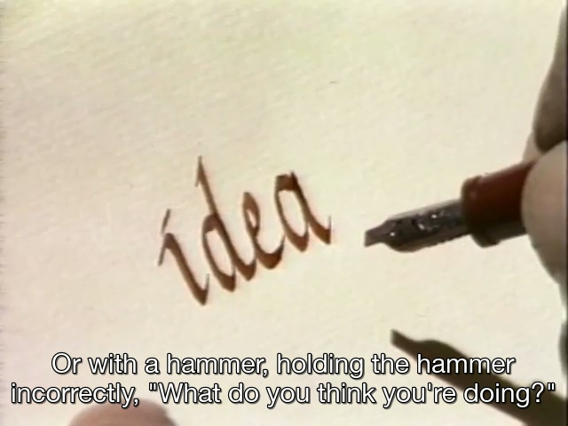
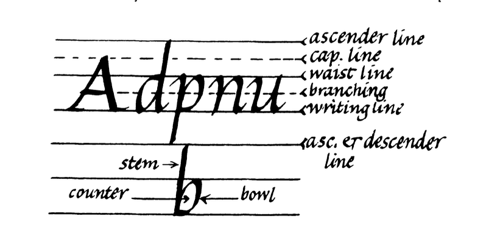
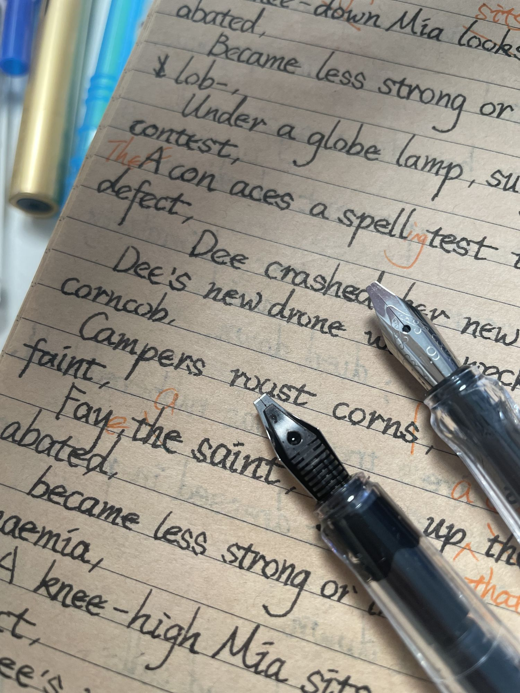

# 「与 AI 同行」电子报 #16

我有些用了一点的病历本。我把前几页撕下来，剩下来的拿来默写单词。钢笔在长条本上写字意外地顺滑。我猜医生们需要更快地书写吧，所以纸面特意造得很光滑。我用过复印纸、笔记本和护眼本，但病历本是最好用的。

说起默写，其实我在默写英文句子。我用 AI 给每个生词造了个句。前半句里有发音暗示词，后半句管词意，整个句子也有画面，方便回想。

英文越写越多，字母天天见，我却开始看不下去了。怎么说呢，不是不能看，是看着越来越闹心。

于是我准备练英文书法。我让 AI 去找些经典教程。它推荐的课程可不便宜。我不好意思花这个钱，因为我还没挣到钱，还在啃老呢。我又在 YouTube 上逛来逛去，忽然记起里德学院有英文书法课。我跑去它家官网，找到了教学视频，而且免费，真是太好了！

我是从苹果公司 CEO 乔布斯那里听说里德学院的。他那时在斯坦福大学演讲。他讲到自己辍学，当旁听生，学了自己喜欢的书法课。这个经历后来启发他设计了苹果电脑里有名的排版系统。

我也学过这门课。但那时我的词汇量不大，自己也不知道这一点，很多细节我听不出来。我只觉得学不会，就放弃了。

可现在不一样了。有了四十个熟词打底，我听出了很多细节。就像长年眼花的人终于肯买眼镜了，镜框一架在鼻梁上，他马上就能看清之前模糊的小字了。

AI 早先推荐的是花体字，而这个课程教的是斜体。我本觉得这两种字体差不多。直到我了解了一段不为人知的书写故事。

最早人们把木棍削尖，沾上墨汁写字。后来有人把笔削平，写出了优雅的斜体字。人们只要控制好角度，就可以写出主干粗、连结细的字体。这要用手腕发力，也不伤手。后来这种写法失传了。人们写字发力开始往手指移动。字写久了，手指会很痛。为了解决这个问题，人们又发明了大臂发力的花体字。后来里德学院重拾传统，公开制作了电视教学节目，让这门手艺又回到了大众眼前，斜体字一度风靡欧洲各国。

练字会用到一种特别的钢笔。它的笔尖像被锋利的刀子削平了，也叫平头钢笔，或者叫鸭嘴笔、藏文笔。用这种钢笔以 45 度角向上推，可以写出很细的线，而保持同样的角度不变，向下拖，可以写出很粗的线条。课程里的英文都是这样写出来的。

看到练习用的例子，我马上想到可以用 AI 控制摄像头，“看”到我写的字，再立刻指出不足。也许我就能更快地进步。但转念一想，写字不光是练手，还要练眼力。用 AI 监督可以做到又快又准，但它也会跳过练眼的过程。离开 AI，我还是写不好字。

我还是乖乖地用眼睛找错吧。

练这种字，要有带标线的纸。一行英文有六条标线：底线、腰线、大写线等等。

它们之间相互平行，基本宽度是五个笔尖宽。我买了一套四十多块的钢笔套装，从 2.5mm 到 0.7mm 一共六支。

我寻思，哪怕是一支 2.5mm 的笔，AI 做出来的标线模板肯定有不小的误差，应该都要调很久吧。

谁知 AI 一次就做对了！我拿尺子去量，宽度精准。AI 还支持不同笔宽，下次告诉它新的笔宽，另一张精确的练习纸就打印好了。

AI 也不是次次都能做对。我让它把两页打在一张 A4 纸上。照理说，它应该能想到把纸横过来，并排打印。但它第一次还是打成了竖排，只有一页完整，另一页只印了一半。好在纠正一次，它就改好了。

最后轮到我自己练字了。我要用自己的手去感觉，用自己的眼睛去观察。AI 帮不上我了，也不应该帮，不是吗？
