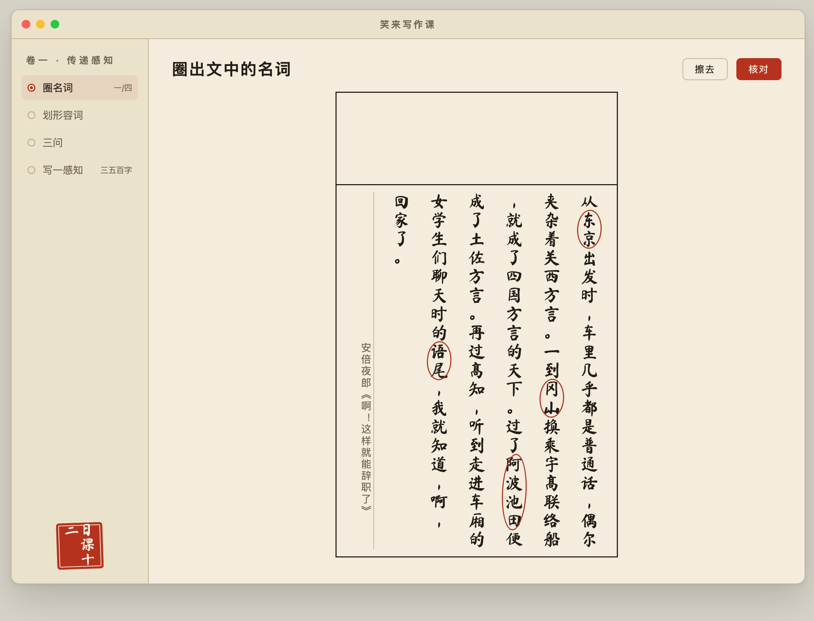
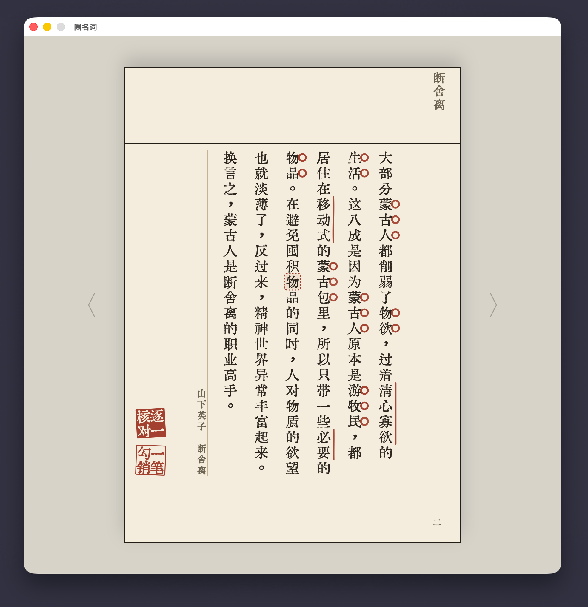

# 「与 AI 同行」电子报 #18：用爱设计的 app，我也爱看

人行道旁的泊油路黑黢黢的，糙得像张砂纸。阳光透过树叶洒下来，光斑不多。往上叠几片亮黄的枫叶当头发；取两片红得透紫的长条叶子，向左边横着放好，一条被风吹起的围巾就有了；再多拣几片还绿着的落叶，拼成梯形，一个小王子就摆出来了。如果还能找到红色的枫叶就更好了，放在小王子身边——那是他独一无二的玫瑰。

能用简单的落叶拼出这么浪漫的画面，可真棒啊！

这周我又看了李笑来老师的写作课。有个作业，是在一段文字里圈出名词和形容词，看看作者是怎么用简单的文字把感觉传递出来的。就像在拼落叶。

这个作业要每天做，还要做上很多年，那就做个 app 吧。每天一段文字摆在眼前，我在上面圈名词和形容词，圈完 app 记下答案，再让 AI 对一遍。对的时候，它把自己的圈并排摆在我旁边，还写两句哪儿圈偏了。

这周我就动手了。既然是练习，那就以专注为主。所以我第一个想到的就是古文的竖排。

跟古文有关的东西我一直很喜欢（也说不清为什么）。竖排和平常的读书顺序不一样，我看文字的时候会不自觉地慢下来。专注力就上来了。

我和 Claude Code 大概说了下想法，初版就有了。

初版该有的都有了：竖排、圈词、对答案。功能不缺，可样子土，看着没劲。

之后两天，我和 AI 十几轮筛下来。工具栏的按钮换成了印章，导航挪到前面当书的目录，正文换上了带纹理的字体。定版是这样的：

第三天我琢磨着应该是「用爱设计」的原则起作用了。这次我没管别人想要什么，只挑我自己喜欢的来。比如竖排。我也纠结过要不要用大家熟悉的横排，但想起自己喜爱的竖排，就果断选了它。自己开心这条原则一定，很多决定就简单了。

我以前做 app 设计，要从一大堆的方案里选，光想一下就头疼。现在凭感觉选就行了。而且直觉反应很快，就像认识新朋友，我看一眼就知道合不合得来。

定版我能开心地瞅上老半天。

> 「如果我们讲故事，我们得相信这个故事和里面的人物真的存在。如果我们想打动观众，我们要先打动自己。我们可没办法传递自己都感知不到的东西。」
>
> —— Marcos Mateu-Mestre · FRAMED INK

我相信 Marcos 的说法，能打动别人的设计，得先打动我自己。

---

「与 AI 同行」争取每周一发刊。

如果你对我的内容有什么想法，可以直接回复这封信告诉我。

PS：你收到这封邮件是因为你订阅了我的电子报。你随时都可以取消订阅。
