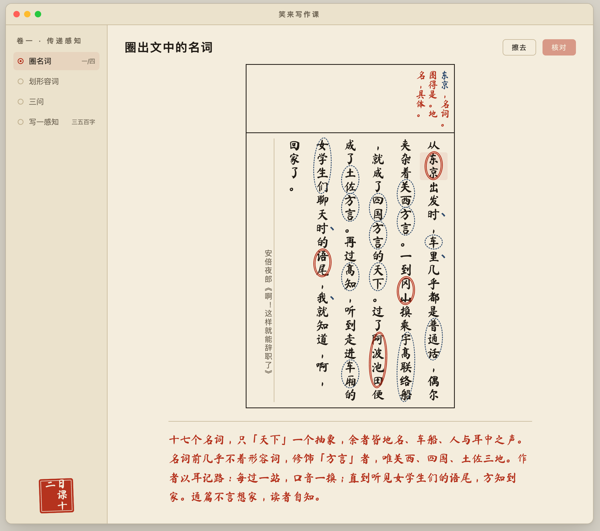
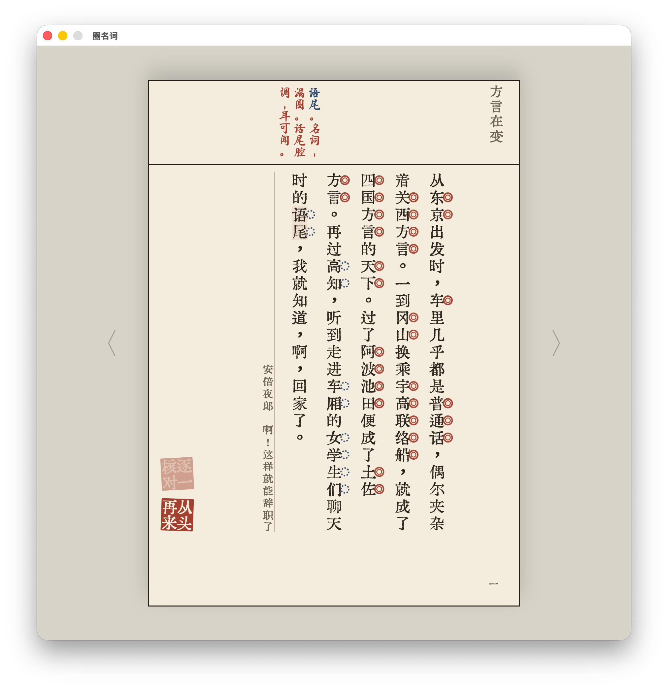

# 「与 AI 同行」电子报 #18：做让自己开心的 app，更简单

有人蹲在人行道上，用落叶拼了个小王子。

柏油路黑黢黢的，糙得像张砂纸，叶子贴在上面挺稳。阳光从树缝里漏下来，有两三块亮光。把亮黄的枫叶叠上去当头发；往左边摆两片红得透紫的长条叶子，一条给风吹起来的围巾就有了；再拣几片还绿着的，拼成上窄下宽的身子，一个小王子就有了。要是能再捡到一片红枫叶就更好了，放在小王子身边——那是他独一无二的玫瑰。

就几片落叶，拼出这么浪漫的东西，真棒啊！

这周我又看了李笑来老师的写作课。有个作业，是在一段文字里圈出名词和形容词，看看人家是怎么用文字把感觉递到你眼前的。就像看那幅落叶画——一眼就能认出，是哪几片叶子把整幅画撑起来的。

这个作业要每天做，还要做上很多年，那我就做个 app 吧——纸上的圈存不住，也没人帮我对。头一版我把作业拆成了四步：圈名词、划形容词、答三个问题、写一段感受。每天一段文字摆在眼前，我在上面圈名词和形容词，圈完 app 把我的圈存下来，再让 AI 对一遍。对的时候，它把自己的圈也画在同一页上，还写出来哪儿圈偏了。

既然是练习，那就得先慢下来才坐得住。所以我第一个想到的，就是老书那样的竖排。

竖排和平常的读书顺序不一样，一看文字，我自己就慢下来了。人也定住了。

我和 Claude Code——一个我用惯的 AI 写代码工具——大概说了下想法，几分钟就有初版了，先拿一段旧文试了试。

初版该有的都有了：竖排、圈词、对答案。功能一个不缺，可左边一列任务清单，顶上一个大标题，看着像个后台，不好看。

后来两天，我和 AI 十几轮改下来。侧边栏和大标题都收拾掉，四个步骤只留下圈名词和划形容词，另外两步先挪出去，留着以后做；正文成了一页摊开的书，右上竖着篇名，翻页是书页两边的箭头。最费心思的是原来那两个按钮：一个「擦去」，成了红印章「一笔勾销」；一个「核对」，成了「逐一核对」。核对完，「一笔勾销」那枚就换成「从头再来」。定版是这样的：

粗的红圈是我圈的，细的、中间点一个点的，是它圈的。

第三天我琢磨着，「自己开心」这条原则其实从第一版就在起作用，只是我没给它起名字。说白了，就是只挑让自己开心的来——跟老书有关的东西我一直很喜欢，也说不清为什么：竖排当时跟自己说是为了慢下来，其实还是自己喜欢。我也纠结过要不要用大家熟悉的横排，最后凭感觉定了竖排。到了定版，我也没管别人想要什么，印章、书页，全挑自己喜欢的来。这条原则定下来之后，很多决定就变简单了。

我以前做 app 设计，要从一大堆的方案里选，光想一下就头疼。现在凭感觉选就行了，而且还快——就像认识新朋友，看一眼就知道合不合得来。

定版我能开心地瞅上老半天。

练习还没开始，先把工具做舒服了。

> 如果我们想打动观众，我们要先打动自己。我们可没办法传递自己都感知不到的东西。
>
> Marcos Mateu-Mestre · FRAMED INK

别人打不打动，是后面的事。先自己这一关：打动不了自己，拿什么去打动人。

小王子见过那么多玫瑰，他只认自己的那一朵；我做 app 也这样，只认自己一样一样挑出来的这一版——独一无二。

---

「与 AI 同行」争取每周一发刊。

如果你对我的内容有什么想法，可以直接回复这封信告诉我。

PS：你收到这封邮件是因为你订阅了我的电子报。你随时都可以取消订阅。
